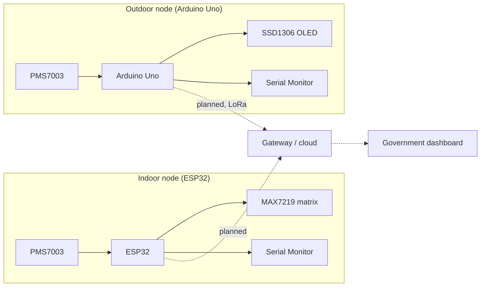

# TUFAN: Traffic & Urban Forecasting with Agentic Neural-Intelligence

Urban environmental monitoring project by **Team TUFAN**, University of Engineering and Management (UEM), Kolkata.

This repository currently holds the **embedded firmware** for two particulate-matter (PM) monitoring nodes and a `webapp/` folder for the dashboard. Each node reads a PMS7003 sensor, computes an Indian CPCB-style AQI from PM2.5 and PM10, and shows it on a local display.

> **Status note:** Only the firmware is documented in detail below. Wireless transmission, cloud ingestion and the dashboard's behaviour are not described here because they are not confirmed in the firmware (see [Implementation status](#implementation-status)).

---

## Problem and objectives

Urban air quality varies street by street, but monitoring stations are sparse and expensive. TUFAN aims to:

- Build low-cost indoor and outdoor PM monitoring nodes.
- Compute a standard AQI on-device so readings are meaningful without a server.
- Feed collected data into a central dashboard for government-level viewing and analysis.

Estimated hardware cost from the project presentation: **₹4,500 (indoor)** and **₹1,550 (outdoor)**. These are estimates, not measured bills of materials.

## Implementation status

| Component | Status | Evidence in repo |
|---|---|---|
| Indoor node firmware (ESP32 + PMS7003 + LED matrix) | Working sketch | `esp_dis.ino` |
| Outdoor node firmware (Arduino Uno + PMS7003 + OLED) | Working sketch | `Uno_outdor.ino` |
| On-device AQI calculation (PM2.5, PM10) | Implemented | Both sketches |
| Government dashboard | Folder present, not documented | `webapp/` |
| LoRa link between nodes and a gateway | Not in repo | Planned in project design |
| Wi-Fi / MQTT / HTTP upload from nodes | Not in repo | Neither sketch sends data over a network |
| AWS ingestion, storage, APIs | Not in repo | No cloud code or config found |

Mapping `esp_dis.ino` to the indoor module and `Uno_outdor.ino` to the outdoor module is inferred from file names and the project context. The outdoor sketch targets an Arduino Uno with an OLED and has no LoRa code, which differs from the ESP32 + LoRa outdoor design in the project plan.

## Modules

### Indoor monitoring node (`esp_dis.ino`)

- **Board:** ESP32 DevKit (v1.1 per the code comment).
- **Sensor:** PMS7003 on UART2, 9600 baud, sensor TX to GPIO16. ESP32 TX is not connected.
- **Display:** 4-in-1 MAX7219 (FC16) LED matrix via MD_Parola.
- **Behaviour:** reads PM1.0, PM2.5 and PM10 (atmospheric-environment values), keeps the latest reading, and every 5 seconds prints a report to the Serial Monitor (115200 baud) and shows `AQI:<n>` on the matrix. Matrix brightness is set to the minimum.

| Signal | ESP32 pin |
|---|---|
| PMS7003 TX | GPIO16 |
| MAX7219 DIN | GPIO23 |
| MAX7219 CLK | GPIO18 |
| MAX7219 CS | GPIO5 |

### Outdoor monitoring node (`Uno_outdor.ino`)

- **Board:** Arduino Uno.
- **Sensor:** PMS7003 via SoftwareSerial (RX = D2, TX = D3), 9600 baud. The sketch wakes the sensor and uses passive mode, requesting a reading each cycle, so D3 must also be wired to the sensor's RX for those commands to reach it.
- **Display:** 128x64 SSD1306 OLED over 4-wire hardware SPI (CS = D10, DC = D9, RESET = D8) using U8g2.
- **Behaviour:** every 5 seconds shows AQI, category, PM2.5 and PM10 on the OLED and prints them over Serial (9600 baud). If no data arrives it shows a "Waiting for PMS7003" message.

### Government dashboard (`webapp/`)

A `webapp/` directory exists in the repository. Its framework, pages and data source were not reviewed for this README, so no features are claimed. Fill this section in from the folder's contents.

## AQI calculation

Both sketches compute a PM2.5 sub-index and a PM10 sub-index by linear interpolation over CPCB-style breakpoints, then report the **higher** of the two as the overall AQI.

| AQI | Category |
|---|---|
| 0-50 | Good |
| 51-100 | Satisfactory |
| 101-200 | Moderate |
| 201-300 | Poor |
| 301-400 | Very Poor |
| 401-500 | Severe |

The outdoor sketch labels its calculation "indicative". Treat both as approximate, not regulatory-grade, readings.

## Architecture

What exists today is two standalone nodes. The dashed path is planned, not implemented in this repo.



## Technology stack

| Area | Technology |
|---|---|
| Language | C++ (Arduino sketches) |
| Boards | ESP32 DevKit, Arduino Uno |
| Sensor | Plantower PMS7003 |
| Displays | MAX7219 4-in-1 matrix, SSD1306 128x64 OLED |
| Libraries | `PMS`, `MD_Parola`, `MD_MAX72xx`, `U8g2`, `SPI`, `SoftwareSerial` |
| Dashboard | See `webapp/` (not reviewed) |

## Repository structure

```
tufan/
├── esp_dis.ino      # Indoor node: ESP32 + PMS7003 + MAX7219
├── Uno_outdor.ino   # Outdoor node: Arduino Uno + PMS7003 + SSD1306 OLED
├── webapp/          # Dashboard (contents not documented yet)
└── LICENSE          # MIT
```

Arduino IDE expects a sketch file to sit in a folder with the same name. Before opening, place each `.ino` in a matching folder (e.g. `esp_dis/esp_dis.ino`).

## Getting started (firmware)

### Prerequisites

- Arduino IDE 2.x (or Arduino CLI).
- For the indoor node: ESP32 board support (Espressif's "esp32" package in Boards Manager).
- Libraries, installed from the Library Manager: **PMS Library**, **MD_Parola**, **MD_MAX72xx**, **U8g2**.

### Flash the indoor node

1. Wire the board per the pin table above.
2. Open `esp_dis.ino` and select **ESP32 Dev Module** and your COM port.
3. Upload, then open Serial Monitor at **115200** baud.

### Flash the outdoor node

1. Wire the PMS7003 and OLED as listed above.
2. Open `Uno_outdor.ino` and select **Arduino Uno**.
3. Upload, then open Serial Monitor at **9600** baud.

No API keys, credentials or environment variables are used by either sketch.

## AWS and deployment

No AWS code, infrastructure definitions or deployment configuration were found in the firmware. Cloud architecture is a roadmap item, not a current feature. For the dashboard, check `webapp/` for its own setup instructions.

## Limitations and roadmap

**Current limitations**

- Nodes display and print readings only; nothing is stored or transmitted.
- No Wi-Fi, LoRa, MQTT or HTTP code.
- The outdoor node uses an Arduino Uno, not the ESP32 + LoRa design in the plan.
- AQI is computed from PM2.5 and PM10 only; no gas, temperature or humidity sensing.
- No calibration against a reference instrument and no automated tests.

**Roadmap**

- [ ] LoRa transmission from outdoor nodes to a gateway.
- [ ] Network upload from indoor nodes.
- [ ] Cloud ingestion, storage and API layer (AWS under consideration).
- [ ] Dashboard connected to live node data.
- [ ] Sensor calibration and field validation.

## Team and acknowledgements

Team TUFAN, University of Engineering and Management, Kolkata.
Repository maintainer: [@deb8367](https://github.com/deb8367).
Add team member names and faculty mentors here.

## License

Released under the [MIT License](LICENSE).
